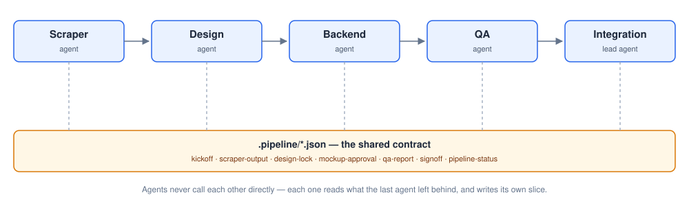

# SiteRelay

A multi-tenant, multi-agent pipeline for building small-business client websites — five
specialized Claude Code subagents that build a site end to end, each one picking up exactly
where the last one left off.



## What this actually is

This repo is **not** a website builder itself — it's the *contract layer* one is built on top of:
JSON Schemas for every file the pipeline passes between stages, the five subagent definitions
that read/write those files, the hooks that mechanically enforce each agent's write boundaries
(so an agent can't quietly step outside its own lane), and the CLI scripts those agents call out
to for everything that needs a real secret or a real external API (Google Places, Gemini image
generation, GitHub, Vercel).

There's no live client and no orchestrator implementation yet — that's the next layer up, meant
to be built on top of this contract rather than mixed into it.

## How a client moves through it

```
kickoff → scraping → design_homepage → mockup_review → mockup_revision →
design_locked → design_remaining_pages → backend_build → qa → qa_revision →
integration_signoff → complete
```

(plus a `blocked_needs_human` escape hatch, reachable from a revision loop whose round cap is
exceeded, or from signoff when a QA kick-back is needed but no rounds remain)

- **Scraper agent** gathers the client's real business data (site, Google Places, web search) —
  once, before any design work starts.
- **Design agent** builds the actual Next.js site and captures mockup screenshots for approval.
- **Backend agent** wires in real server-side logic (payments, scheduling, forms, CMS) — never
  creates new UI.
- **QA agent** runs an adversarial functional + accessibility + visual-regression pass against a
  local production build.
- **Integration lead agent** pushes the final QA-passed code to the client's own GitHub repo and
  promotes it to production once the client signs off.

No agent ever calls another directly. Each one reads whatever the previous stage left behind under
that client's `.pipeline/` directory, and writes only its own slice — the JSON schema is the
entire interface between them, and a `PreToolUse` hook enforces each agent's write boundary for
real, not just by instruction.

## Start here

- [`CLAUDE.md`](./CLAUDE.md) — operating instructions and architecture reference for Claude Code.
- [`docs/PROJECT_SUMMARY.md`](./docs/PROJECT_SUMMARY.md) — narrative overview of the *why*.
- [`docs/spec.md`](./docs/spec.md) — authoritative field-by-field schema reference.

## Commands

```bash
bun test                                             # full suite
bun test tests/schemas/kickoff.test.ts               # a single schema test
bun test tests/agents/<name>-output.dry-run.test.ts  # a single agent's dry-run output validation
bun test tests/hooks/validate-<name>-agent.test.ts   # a single hook's unit tests
```

There's no build/lint step — `bun` runs `.ts` files directly, and `tsconfig.json` (`noEmit: true`)
is editor-only. The one exception is `scripts/a11y-audit.ts`, which runs under
`node --experimental-strip-types` (see that file's own header for why).
